<picture>
  <source media="(prefers-color-scheme: dark)" srcset="assets/header-dark.svg">
  <source media="(prefers-color-scheme: light)" srcset="assets/header-light.svg">
  
</picture>

<picture>
  <source media="(prefers-color-scheme: dark)" srcset="assets/about-skills-dark.svg">
  <source media="(prefers-color-scheme: light)" srcset="assets/about-skills-light.svg">
  
</picture>

## Featured Projects

| Project | Description | Link |
|---|---|---|
| **🧠 RAG Vision AI Assistant** | Local RAG, OCR, evidence-grounded answers, and page-level citations. | [Explore project](https://github.com/abinash123hg/retrieval-augmented-vision-ai-assistant) |
| **🤖 MCP WebPilot** | Browser-agent project exploring MCP, page observation, Playwright actions, and safety audit logs. | [Explore project](https://github.com/abinash123hg/MCP-) |

## Tech Stack

- **Primary language:** Python
- **Languages:** Java, C++, JavaScript, TypeScript, HTML, CSS
- **AI / ML & tools:** PyTorch, TensorFlow, OpenCV, scikit-learn, Git, GitHub, Linux, VS Code
- **Focus:** RAG, MCP, OCR, Computer Vision, AI agents

<picture>
  <source media="(prefers-color-scheme: dark)" srcset="assets/stats-dark.svg">
  <source media="(prefers-color-scheme: light)" srcset="assets/stats-light.svg">
  
</picture>

  
  
   
  

## Connect

- [GitHub](https://github.com/abinash123hg)
- [LinkedIn](https://www.linkedin.com/in/abinash-swain-a941a3330/)
- [Portfolio](https://abinash-swain-portfolio.netlify.app/)
- [Email](mailto:swainabinash839@gmail.com)

<picture>
  <source media="(prefers-color-scheme: dark)" srcset="assets/footer-dark.svg">
  <source media="(prefers-color-scheme: light)" srcset="assets/footer-light.svg">
  
</picture>

