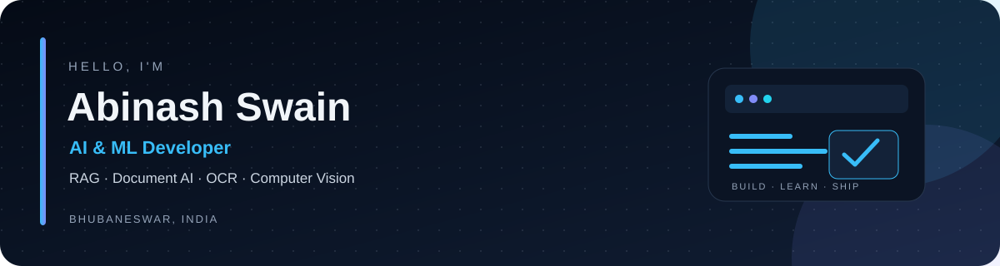

  

  

  
  &nbsp;
  
  &nbsp;
  
  &nbsp;
  

  

---

<h2 align="center">🔴 About Me</h2>

  

  

  Hey! I'm <b>Abinash Swain</b>, a passionate <b>B.Tech 3rd Year CSE (AI & ML) student</b> based in Bhubaneswar, Odisha, India. 
  I specialize in building practical AI systems — Retrieval-Augmented Generation, document understanding, OCR, computer vision, and local multimodal agents that solve real-world problems.

  
  &nbsp;
  
  &nbsp;
  

  💬 <b>Let's Discuss:</b> Python, RAG pipelines, OCR, Computer Vision, Local LLMs, MCP agents & practical AI systems. 
  ⚡ <b>Philosophy:</b> <i>"I love turning ideas into intelligent, grounded, production-ready AI solutions!"</i>

<table width="100%" border="0" align="center">
<tr>
<td width="50%" align="center" style="padding: 14px;">
  <h4>🔭 Flagship Project</h4>
  
<a href="https://github.com/abinash123hg/retrieval-augmented-vision-ai-assistant" target="_blank"><b>DocuLens</b></a> Local RAG + OCR Document Assistant

</td>
<td width="50%" align="center" style="padding: 14px;">
  <h4>🌱 Active Deep Dives</h4>
  
<b>Local LLMs & Multimodal AI</b> MCP Agents & Document Understanding

</td>
</tr>
<tr>
<td width="50%" align="center" style="padding: 14px;">
  <h4>🧠 Current Focus</h4>
  
<b>RAG · OCR · Computer Vision</b> Grounded answers with citations

</td>
<td width="50%" align="center" style="padding: 14px;">
  <h4>🤝 Collaboration</h4>
  
<b>AI / ML / Agents</b> Open to exciting new projects

</td>
</tr>
</table>

---

<h2 align="center">🔴 Featured Project Spotlight</h2>

<table width="100%" border="0" align="center">
<tr>
<td align="center" style="padding: 22px;">
  <h3>🧠 DocuLens — Retrieval-Augmented Vision AI Assistant</h3>
  
<i>Ask questions about PDFs and images using local RAG, OCR, evidence-grounded answers, and page-level citations. Fully local, privacy-first document intelligence.</i>

   
  

    
  

</td>
</tr>
</table>

<table width="100%" border="0" align="center">
<tr>
<td width="50%" align="center" style="padding: 16px;">
  <h4>🤖 MCP WebPilot</h4>
  
Local multimodal browser agent that observes DOM + screenshots, plans Playwright actions, and keeps safety audit logs.

  <a href="https://github.com/abinash123hg/MCP-" target="_blank">View Project →</a>
</td>
<td width="50%" align="center" style="padding: 16px;">
  <h4>📄 Document Understanding Agent</h4>
  
Reads handwritten & scanned pages with OCR + TrOCR, then answers questions with supporting excerpts.

  <a href="https://github.com/abinash123hg/document-understanding-agent" target="_blank">View Project →</a>
</td>
</tr>
</table>

---

<h2 align="center">🛠️ Tech Stack & Skills</h2>

<b>Core Programming Languages</b>

  

<b>AI / ML / Data</b>

  

<b>Backend, Tools & DevOps</b>

  

  
  &nbsp;
  
  &nbsp;
  
  &nbsp;
  
  &nbsp;
  

---

<h2 align="center">📊 GitHub Analytics & Activity</h2>

  
  &nbsp;&nbsp;
  

  

---

<h2 align="center">⚡ Contribution Journey</h2>

  

---

<h2 align="center">📬 Let's Connect & Collaborate</h2>

<i>Whether you want to discuss RAG pipelines, document AI, local agents, or just say hello — my inbox is always open!</i>

<table border="0" align="center">
<tr>
<td align="center" width="220" style="padding: 16px;">
  <a href="https://www.linkedin.com/in/abinash-swain-a941a3330/" target="_blank">
    
      
    
  </a>
   
  <b>Professional Network</b>
</td>
<td align="center" width="220" style="padding: 16px;">
  <a href="https://abinash-swain-portfolio.netlify.app/" target="_blank">
    
      
    
  </a>
   
  <b>Projects & Work</b>
</td>
<td align="center" width="220" style="padding: 16px;">
  <a href="mailto:swainabinash839@gmail.com">
    
      
    
  </a>
   
  <b>Direct Collaboration</b>
</td>
</tr>
</table>

  

Built with ❤️ using Markdown + lightweight SVG artwork

