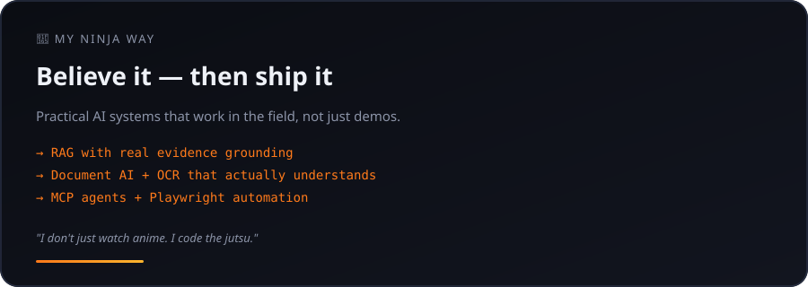
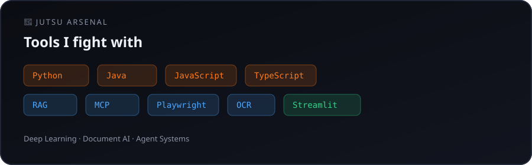
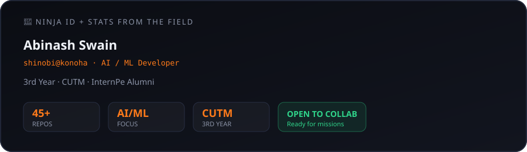
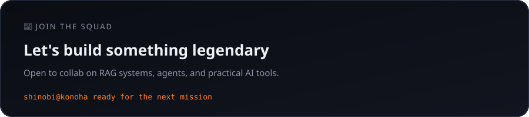

<!-- 🎬 HERO -->

  

 

<!-- 🍥 MY NINJA WAY -->

  

<!-- 🔦 JUTSU ARSENAL -->

  

<!-- 🪪 NINJA ID -->

  

## 🍥 S-Rank Missions

<table>
<tr>
<th>Mission</th>
<th>What it is</th>
<th>Jutsu used</th>
</tr>
<tr>
<td><a href="https://github.com/abinash123hg/retrieval-augmented-vision-ai-assistant"><b>RAG Vision AI Assistant</b></a></td>
<td>Local RAG + OCR with page-level citations and evidence grounding</td>
<td><code>Python</code> <code>RAG</code> <code>OCR</code></td>
</tr>
<tr>
<td><a href="https://github.com/abinash123hg/MCP-"><b>MCP WebPilot</b></a></td>
<td>Browser agent workflows using MCP + Playwright + safety audit logs</td>
<td><code>MCP</code> <code>Playwright</code></td>
</tr>
<tr>
<td><a href="https://github.com/abinash123hg/document-understanding-agent"><b>Document Understanding Agent</b></a></td>
<td>Handwritten and scanned document Q and A with local understanding</td>
<td><code>Python</code> <code>OCR</code> <code>RAG</code></td>
</tr>
<tr>
<td><a href="https://github.com/abinash123hg/SafeDrive-AI-Real-Time-Road-Safety-Accident-Hotspot-Prediction-System"><b>SafeDrive AI</b></a></td>
<td>Real-time accident hotspot prediction and road safety system</td>
<td><code>Python</code> <code>ML</code> <code>Streamlit</code></td>
</tr>
</table>

<a href="https://github.com/abinash123hg?tab=repositories"><b>→ See all missions</b></a>

  

### 🌃 My contribution village

*Every commit raises another building — rebuilt automatically every day.*

  

<!-- 💌 JOIN THE SQUAD -->

 

  

 

**Dattebayo — keep coding, keep growing.** 🍥

