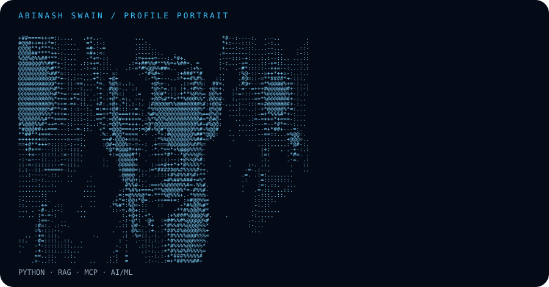
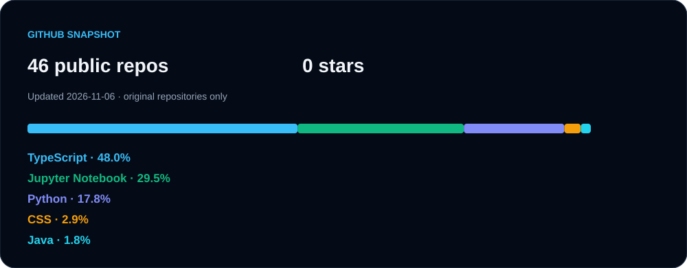

# Abinash Swain

**AI/ML Developer · B.Tech CSE (AI & ML) · Centurion University of Technology and Management, Odisha**

## About

- Third-year B.Tech CSE (AI & ML) student at Centurion University of Technology and Management, Odisha
- AI & Machine Learning and Data Science & Analytics intern at InternPe (Aug 2026 - Sep 2026)
- Build local, evidence-grounded AI tools: RAG pipelines with page-level citations, OCR document understanding, and MCP browser agents
- Practice machine learning and deep learning from scratch (NumPy, PyTorch) alongside DSA in Python
- Open to AI/ML internships and collaboration on applied research projects

## Tech Stack

**Languages**

**ML & Data**

**Tools & Platforms**

## Featured Projects

| Project | Description | Stack |
| --- | --- | --- |
| [RAG Vision AI Assistant](https://github.com/abinash123hg/retrieval-augmented-vision-ai-assistant) | Local RAG + OCR with page-level citations and evidence grounding | Python, RAG, OCR |
| [MCP WebPilot](https://github.com/abinash123hg/MCP-) | Browser agent workflows using MCP + Playwright with safety audit logs | MCP, Playwright |
| [Document Understanding Agent](https://github.com/abinash123hg/document-understanding-agent) | Handwritten and scanned document Q&A with local understanding | Python, OCR, RAG |
| [SafeDrive AI](https://github.com/abinash123hg/SafeDrive-AI-Real-Time-Road-Safety-Accident-Hotspot-Prediction-System) | Real-time accident hotspot prediction and road safety system | Python, ML, Streamlit |

[See all repositories](https://github.com/abinash123hg?tab=repositories)

## GitHub Stats

## Contact

- Email: [swainabinash839@gmail.com](mailto:swainabinash839@gmail.com)
- LinkedIn: [abinash-swain-a941a3330](https://www.linkedin.com/in/abinash-swain-a941a3330/)
- Portfolio: [abinash-swain-portfolio.netlify.app](https://abinash-swain-portfolio.netlify.app/)
