<!-- HEADER -->

I am the sun; my languages are the planets and my projects their moons.

## About

## Projects

 
 
 

[See all repositories](https://github.com/abinash123hg?tab=repositories)

## Skills

**Python** — ML/DL from scratch (NumPy, PyTorch), RAG/OCR pipelines, DSA. Evidence: [python](https://github.com/abinash123hg/python), [RAG assistant](https://github.com/abinash123hg/retrieval-augmented-vision-ai-assistant), [document agent](https://github.com/abinash123hg/document-understanding-agent).
**Java** — OOP, collections, university coursework. Evidence: [2nd-year-java-project](https://github.com/abinash123hg/2nd-year-java-project), [kulu.java](https://github.com/abinash123hg/kulu.java).
**Supporting** — Git, GitHub Actions, Playwright, MCP, Streamlit, scikit-learn, Jupyter.

## Contribution activity

## Contact

- Email: [swainabinash839@gmail.com](mailto:swainabinash839@gmail.com)
- LinkedIn: [abinash-swain-a941a3330](https://www.linkedin.com/in/abinash-swain-a941a3330/)
- Portfolio: [abinash-swain-portfolio.netlify.app](https://abinash-swain-portfolio.netlify.app/)

Solar System · planets are languages, moons are repos, comets are recent pushes · original self-hosted build, snapshot 2026-11-12