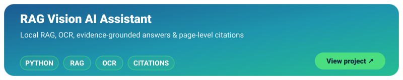

  

  

  
  
  
  

---

### 👨‍💻 About Me

**Abinash Swain**  
3rd-Year B.Tech CSE (AI & ML) @ Centurion University of Technology and Management (CUTM), Bhubaneswar  
Data Analyst Intern @ InternPe

I build practical AI systems focused on:
- **Retrieval-Augmented Generation (RAG)** with evidence and citations
- **Document AI** (OCR + local understanding)
- **Tool-using agents** via MCP
- Clean, reliable automation with Playwright

> Goal: Turn useful ideas into dependable, transparent software — not just demos.

---

### 🚀 Current Focus

| Area | What I'm building |
|------|-------------------|
| Deep Learning | Hands-on experiments with Python & modern architectures |
| RAG & Document AI | Local retrieval, OCR, page-level citations, hallucination control |
| AI Agents & MCP | Structured tool calling + safety audit logs |
| Browser Automation | Reliable Playwright workflows |

---

### 🛠️ Featured Projects

  

  

- **[RAG Vision AI Assistant](https://github.com/abinash123hg/retrieval-augmented-vision-ai-assistant)** — Local RAG + OCR with page-level citations and strong anti-hallucination design.
- **[MCP WebPilot](https://github.com/abinash123hg/MCP-)** — Browser agent using MCP + Playwright with safety audit logs.

---

### 🧰 Tech Stack

  
  
  
  
  
  
  
  

---

### 📊 GitHub Snapshot

  

  
  

---

### 🎓 Education

**B.Tech — Computer Science & Engineering (AI & ML)**  
Centurion University of Technology and Management (CUTM)  
Bhubaneswar, Odisha, India

---

### 💡 Principles

- **Grounded** — Answers must connect to real evidence
- **Practical** — Prefer useful workflows over flashy demos
- **Transparent** — Make automation and safety checks understandable
- **Iterative** — Learn → test → improve → document

---

### 🔗 Let's Connect

Open to collaborating on practical AI/ML projects, RAG systems, document AI, and agent tooling.

  <a href="https://github.com/abinash123hg">GitHub</a> ·
  <a href="https://www.linkedin.com/in/abinash-swain-a941a3330/">LinkedIn</a> ·
  <a href="https://abinash-swain-portfolio.netlify.app/">Portfolio</a> ·
  <a href="mailto:swainabinash839@gmail.com">Email</a>

  Updated November 2026 · Built with care by Abinash Swain

