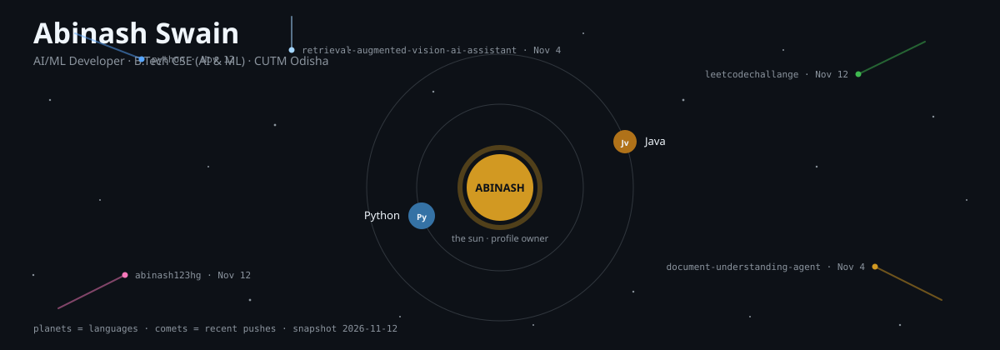

<!-- HEADER -->

## About

- Third-year B.Tech CSE (AI & ML) student at Centurion University of Technology and Management, Odisha
- AI & Machine Learning and Data Science & Analytics intern at InternPe (Aug 2026 - Sep 2026)
- Build local, evidence-grounded AI tools: RAG pipelines with page-level citations, OCR document understanding, and MCP browser agents
- Primary languages: **Java** and **Python** - ML/DL from scratch in Python, OOP and coursework in Java
- Open to AI/ML internships and collaboration on applied research projects

## Projects

| Project | Description | Stack |
| --- | --- | --- |
| [RAG Vision AI Assistant](https://github.com/abinash123hg/retrieval-augmented-vision-ai-assistant) | Local RAG + OCR with page-level citations and evidence grounding | Python, RAG, OCR |
| [MCP WebPilot](https://github.com/abinash123hg/MCP-) | Browser agent workflows using MCP + Playwright with safety audit logs | MCP, Playwright |
| [Document Understanding Agent](https://github.com/abinash123hg/document-understanding-agent) | Handwritten and scanned document Q&A with local understanding | Python, OCR, RAG |
| [SafeDrive AI](https://github.com/abinash123hg/SafeDrive-AI-Real-Time-Road-Safety-Accident-Hotspot-Prediction-System) | Real-time accident hotspot prediction and road safety system | Python, ML, Streamlit |
| [ML/DL + DSA practice](https://github.com/abinash123hg/python) | From-scratch regression, k-means, backprop MLP (NumPy/PyTorch) and DSA solutions with tests | Python, NumPy, PyTorch |
| [Java coursework](https://github.com/abinash123hg/2nd-year-java-project) | Second-year OOP and data-structures coursework in Java | Java |

[See all repositories](https://github.com/abinash123hg?tab=repositories)

## Skills

**Python** - machine learning and deep learning from scratch (NumPy, PyTorch), RAG/OCR pipelines, data analysis with Pandas, DSA practice.
Evidence: [python](https://github.com/abinash123hg/python), [retrieval-augmented-vision-ai-assistant](https://github.com/abinash123hg/retrieval-augmented-vision-ai-assistant), [document-understanding-agent](https://github.com/abinash123hg/document-understanding-agent)

**Java** - object-oriented programming, collections, and university coursework projects.
Evidence: [2nd-year-java-project](https://github.com/abinash123hg/2nd-year-java-project), [kulu.java](https://github.com/abinash123hg/kulu.java), [kulujava](https://github.com/abinash123hg/kulujava)

**Supporting tools** - Git, GitHub Actions, Playwright, MCP, Streamlit, scikit-learn, Matplotlib, Jupyter.

Measured code share across public repos (GitHub linguist, 2026-11-12):
TypeScript 47.9% · Jupyter Notebook 29.5% · Python 17.9% · CSS 2.9% · Java 1.8%

## Contribution activity

## Contact

- Email: [swainabinash839@gmail.com](mailto:swainabinash839@gmail.com)
- LinkedIn: [abinash-swain-a941a3330](https://www.linkedin.com/in/abinash-swain-a941a3330/)
- Portfolio: [abinash-swain-portfolio.netlify.app](https://abinash-swain-portfolio.netlify.app/)
